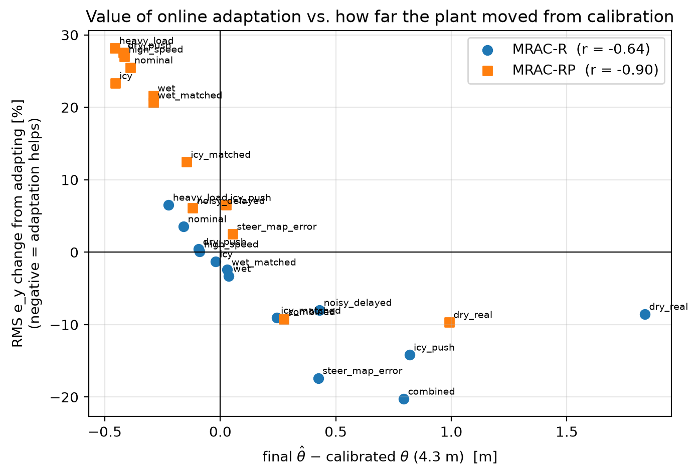

# Adaptive Vehicle Path Tracking in CARLA

Pure Pursuit, Stanley and a delay-robust **direct Model Reference Adaptive Controller (MRAC)**
compared on a Tesla Model 3 in CARLA 0.9.16 (Town03), across 14 road and driving conditions.

The adaptive controller learns one parameter online, the vehicle's effective steering gain, and
is derived with a Lyapunov argument. The study asks a simple question: **when is online
adaptation worth it compared with well-tuned geometric controllers?**



## Key findings

- **Adaptation pays in proportion to plant change.** The error reduction from adapting
  correlates strongly with how far the adapted gain moved from its dry-road calibration
  (r = −0.93 for MRAC-R over the 12 default-grip scenarios). Where the steering response
  changed most (steering-map error, reduced grip at high lateral demand, combined degradation),
  MRAC beat Stanley by **21–34 %** RMS cross-track error.
- **Stanley wins when the vehicle matches its calibration.** In 9 of 14 scenarios Stanley had
  the lowest error; MRAC was up to 60 % worse there.
- **Plain high-gain MRAC is fragile to delay.** With 150 ms actuator delay and sensor noise it
  left the route and its gain estimate drifted to 2.4× the true value. A Stanley-type sliding
  surface, a gain cap and filtered adaptation fixed it.
- **Feedback linearisation fails at the friction limit.** Near peak tyre force every MRAC
  variant left the road, while Stanley and Pure Pursuit stayed on with large errors.
- **CARLA's default grip is about 2.2 g.** A skid-pad test maps CARLA's `tire_friction` to
  measured lateral grip; realistic wet and snow settings were not drivable on Town03.

All numbers below come from `results/summary.csv`; nothing is extrapolated.

## Results

RMS / max cross-track error in metres (vehicle centre, ground truth). **Bold** = lowest RMS.

| Scenario | Pure Pursuit | Stanley | MRAC-R | MRAC-RP |
| --- | --- | --- | --- | --- |
| nominal | 0.271 / 0.842 | **0.071** / 0.190 | 0.106 / 0.345 | 0.113 / 0.339 |
| wet_matched | 0.288 / 0.898 | **0.092** / 0.243 | 0.114 / 0.386 | 0.118 / 0.368 |
| icy_matched | 0.309 / 0.950 | **0.114** / 0.304 | 0.122 / 0.463 | 0.124 / 0.403 |
| heavy_load | 0.266 / 0.837 | **0.063** / 0.181 | 0.100 / 0.344 | 0.109 / 0.328 |
| wet | 0.293 / 0.915 | **0.091** / 0.240 | 0.115 / 0.383 | 0.119 / 0.364 |
| icy | 0.260 / 0.812 | **0.059** / 0.176 | 0.094 / 0.305 | 0.094 / 0.323 |
| high_speed | 0.324 / 1.010 | **0.130** / 0.313 | 0.131 / 0.420 | 0.144 / 0.426 |
| dry_push | 0.322 / 1.023 | **0.130** / 0.311 | 0.132 / 0.422 | 0.144 / 0.430 |
| noisy_delayed | 0.270 / 0.800 | **0.105** / 0.315 | 0.157 / 0.480 | 0.119 / 0.452 |
| steer_map_error | 0.437 / 1.244 | 0.206 / 0.461 | **0.138** / 0.486 | 0.150 / 0.454 |
| icy_push | 0.383 / 1.181 | 0.213 / 0.583 | 0.180 / 0.865 | **0.169** / 0.553 |
| combined | 0.408 / 1.111 | 0.189 / 0.485 | 0.151 / 0.572 | **0.125** / 0.440 |
| dry_real (μ ≈ 0.9) | 0.318 / 1.000 | 0.186 / 0.656 | 0.225 / 0.998 | **0.170** / 0.813 |
| dry_real_push | **0.634** / 2.114 | 0.799 / 2.550 | left road at 24 % | left road at 29 % |

Three noise seeds change RMS error by at most 0.002 m (e.g. combined: Stanley 0.190 ± 0.001,
MRAC-RP 0.124 ± 0.001), far below the gaps between controllers. MRAC steers more actively:
13–20 °/s RMS steering rate in clean runs against 9–13 °/s for Stanley, and 82 °/s against
38 °/s in `noisy_delayed`.

| Figure | Shows |
| --- | --- |
| [fig1](results/final/fig1_error_by_scenario.png) | RMS and max error per scenario (hatched = left the road) |
| [fig2](results/final/fig2_adaptation_value.png) | Error change from adapting vs. shift of θ̂ from calibration |
| [fig3](results/final/fig3_theta_hat.png) | Adapted gain θ̂ along the route |
| [fig4](results/final/fig4_traces_combined.png) | Traces: combined degradation |
| [fig5](results/final/fig5_traces_steer_map.png) | Traces: steering-map error |
| [fig6](results/final/fig6_delay_robustness.png) | High-gain vs. robust MRAC under delay and noise |
| [fig7](results/final/fig7_limit_failure.png) | Friction-limit failure |

Full tables: [`results/final/tables.md`](results/final/tables.md).

## Controllers

| Name in code | Label | Description |
| --- | --- | --- |
| `pure_pursuit` | Pure Pursuit | rear axle, look-ahead 0.35 v + 4 m (4–30 m) |
| `stanley` | Stanley | front axle, k = 1.2, k_s = 1.0, no curvature feedforward |
| `adaptive_mrac_cal` | high-gain MRAC | original design, θ̂₀ = 4.3 m |
| `adaptive_mrac_rob` | **MRAC-R** | delay-robust MRAC (k_e = k_max = 2.0, filtered adaptation) |
| `adaptive_mrac_rob_prev` | **MRAC-RP** | MRAC-R + 0.2 s curvature preview |
| `*_fixed` | ablation | same controller with adaptation off (γ = 0, θ = 4.3 m) |

The adaptive law, in short (full derivation in [`docs/METHOD.md`](docs/METHOD.md)):

$$s = e_\psi + \arctan(\lambda e_y),\qquad \nu = -k s - f,\qquad \tan\delta = \frac{\hat\theta\,\nu}{v},\qquad \dot{\hat\theta} = -\gamma\,s\,\nu$$

$$V = \tfrac12 s^2 + \frac{b}{2\gamma}\tilde\theta^2 \ \Rightarrow\ \dot V = -k s^2 \le 0$$

## Scenarios

| Group | Scenarios | What changes |
| --- | --- | --- |
| Baseline | `nominal` | 40 km/h, CARLA default grip |
| Speed | `high_speed`, `dry_push` | 70 km/h; 50 km/h at 4.5 m/s² lateral |
| Grip (relative to default) | `wet`, `icy`, `wet_matched`, `icy_matched`, `icy_push` | tyre friction × 0.55 or × 0.3 |
| Load | `heavy_load` | mass × 1.6 |
| Actuator | `steer_map_error` | CARLA's speed-dependent steering reduction left on |
| Sensing | `noisy_delayed` | 0.1 m / 0.5° noise, 150 ms steering delay |
| Mixed | `combined` | grip × 0.55, mass × 1.4, steering curve on, noise, 100 ms delay |
| Calibrated grip | `dry_real`, `dry_real_push` | measured μ ≈ 0.9, μ-aware speed profile |

All runs share one 606 m Town03 reference (`results/reference_town03.npz`, spawn 174 → 15),
one speed profile per scenario and the same PI speed loop, so controllers differ only in their
steering law. Cross-track error is measured at the vehicle centre; heading error at the rear axle.

## Repository layout

```
├── config.py            simulator, route and limit settings
├── vehicle_state.py     CARLA-free state containers and frame helpers
├── sim_utils.py         the only CARLA-specific code: connect, spawn, physics, frame conversion
├── reference_path.py    Town03 route -> smoothed path, curvature, speed profile, projection
├── controllers.py       Pure Pursuit, Stanley, direct MRAC, speed PI, named PRESETS
├── scenarios.py         the 16 scenario definitions (14 used in the study)
├── run_experiments.py   runs scenario × controller, logs traces and results/summary.csv
├── skidpad.py           flat OpenDRIVE pad: tire_friction -> measured lateral grip
├── offline_check.py     CARLA-free kinematic simulation: signs and adaptation sanity check
├── make_figures.py      final figures and tables -> results/final/
├── analyze.py, diag.py  quick per-scenario plots; single-run diagnosis
├── run_all.sh           reproduces every result
├── docs/METHOD.md       conventions, derivation, robust redesign, grip calibration
└── results/             summary.csv, reference route, final figures and tables
```

## Getting started

Requirements: Ubuntu 22.04/24.04, CARLA 0.9.16 (UE4), Python 3.10–3.12.

```bash
git clone https://github.com/munavirzaman-git/carla-adaptive-path-tracking.git
cd carla-adaptive-path-tracking
python3 -m venv .venv && source .venv/bin/activate
pip install -r requirements.txt
export CARLA_ROOT=/path/to/CARLA_0.9.16          # for agents.navigation (route planner)

python offline_check.py                           # no simulator needed
```

Start the simulator in another terminal (`$CARLA_ROOT/CarlaUE4.sh -quality-level=Low`), then:

```bash
python run_experiments.py -c stanley adaptive_mrac_rob_prev -s nominal combined --spectator
python make_figures.py
```

`run_experiments.py` options: `-c` controllers or presets, `-s` scenarios, `--gains` JSON
overrides, `--tag` result-name suffix, `--noise-seed`, `--new-route`, `--spectator`.
Use another port with `CARLA_PORT=4000` (and `-carla-rpc-port=4000` on the server).

**Reproduce everything** (about 110 runs, 2–3 hours): `./run_all.sh`.

## Limitations

- **One route, one vehicle.** All results come from a single 606 m Town03 route.
- **Simulator grip.** CARLA's default grip (≈ 2.2 g) is about twice a real car's, so the
  default-relative "wet"/"icy" scenarios are relative friction reductions, not real roads.
  Lowering `tire_friction` to realistic wet or snow values also removes cornering stiffness and
  traction, and the car could not complete Town03; those scenarios are defined but excluded.
- **Kinematic error model.** The MRAC assumes a kinematic bicycle; tyre slip is absorbed into θ̂.
- **Friction limit.** The design assumes the steering gain stays positive, which fails past peak
  tyre force; the controller needs saturation-aware handling there.
- **Preview–adaptation interaction.** With curvature preview, θ̂ drifts below its calibrated
  value on calm roads (3.84–4.01 m), making MRAC-RP's adaptation 20–28 % worse than holding θ̂
  fixed there. A fix (adapting on the non-previewed error model) is untested in CARLA.

## Future work

Dynamic-bicycle error model with tyre slip · CARLA's Project Chrono vehicle dynamics for
realistic low-grip roads · friction-limit-aware adaptation · μ-split and sudden ice patches
(`static.trigger.friction`) to measure adaptation speed · multiple towns and routes · ROS 2 nodes.

## Author

**Munavir Zaman P K** · [GitHub](https://github.com/munavirzaman-git) ·
ORCID [0009-0001-4537-6234](https://orcid.org/0009-0001-4537-6234)

Released under the [MIT License](LICENSE).
