<p align="center">
  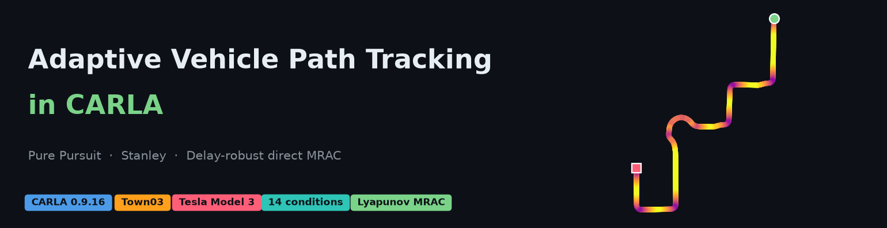
</p>

<p align="center">
  
  
  
  
  
  
</p>

<p align="center">
  <b>Pure Pursuit</b> &nbsp;·&nbsp; <b>Stanley</b> &nbsp;·&nbsp; <b>delay-robust direct MRAC</b> &nbsp;·&nbsp; <b>MPC + adaptive MPC (OSQP)</b>
  &nbsp;|&nbsp; Tesla Model 3 &nbsp;·&nbsp; Town03 &nbsp;·&nbsp; 14 road and driving conditions
  <br>
  <a href="#-demos">Demos</a> ·
  <a href="#-key-findings">Findings</a> ·
  <a href="#-results">Results</a> ·
  <a href="#-how-it-works">How it works</a> ·
  <a href="#-getting-started">Getting started</a> ·
  <a href="docs/METHOD.md">Method</a>
</p>

---

Two adaptive controllers learn the car's **effective steering gain** online: a **direct MRAC**
(Lyapunov-derived, adapts from tracking error) and an **indirect adaptive MPC** (recursive least
squares on yaw rate, re-optimised every step with OSQP). The study asks: **when is online
adaptation worth it compared with well-tuned geometric and model-predictive controllers?**

> [!TIP]
> **Answer: in proportion to how far the vehicle moves from its calibration.** Model-based control
> (MPC) had the lowest error in **9 of 14** scenarios; relative adaptive MPC beat Stanley by
> **24–46 %** where the steering response changed. Where nothing changed, Stanley kept the lowest error.

## 🎬 Demos

<p align="center">
  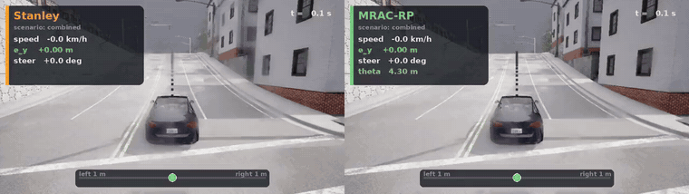
  <br><sub><b>combined</b> (low grip + load + steering-map error + noise + delay): Stanley (left) vs MRAC-RP (right).
  The HUD bar shows live cross-track error.</sub>
</p>

<table>
  <tr>
    <td width="50%">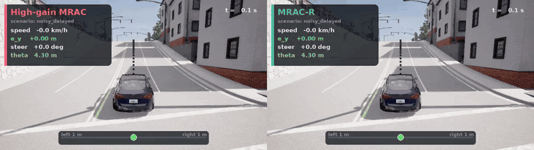<br>
      <sub>🔴 <b>150 ms delay + noise</b>: the original high-gain MRAC oscillates and spins; the delay-robust MRAC-R stays on the line.</sub></td>
    <td width="50%">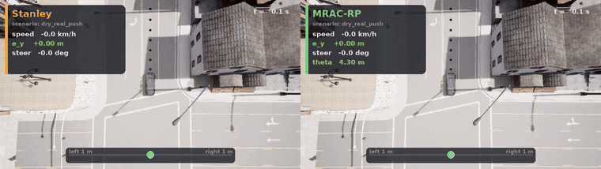<br>
      <sub>⚠️ <b>At the friction limit</b> (μ ≈ 0.9, 0.4 g demand): Stanley survives, MRAC runs out of grip and leaves the road.</sub></td>
  </tr>
  <tr>
    <td width="50%">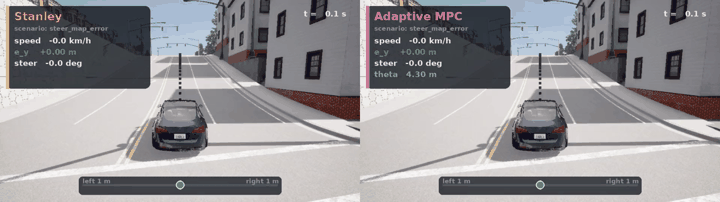<br>
      <sub>🟢 <b>Unknown steering gain</b>: CARLA's speed-dependent steering reduction. Adaptive MPC learns it (watch θ̂ rise in the HUD) and cuts Stanley's error by 46 %.</sub></td>
    <td width="50%">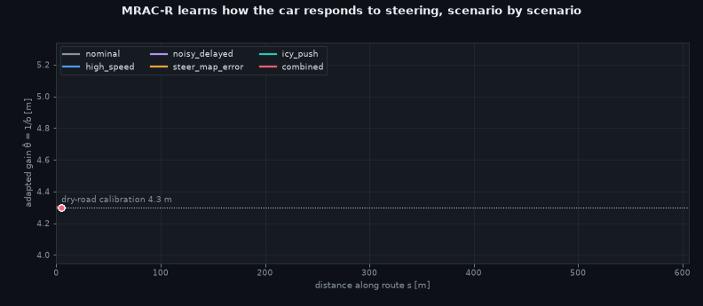<br>
      <sub>📈 <b>What the adaptation learns</b>: θ̂ climbs where the car turns less than calibrated.</sub></td>
  </tr>
</table>

<details>
<summary><b>▶ Full-length videos (MP4)</b></summary>

| Scenario | View | Side by side | Individual runs |
| --- | --- | --- | --- |
| combined | chase | [▶ video](media/videos/combined_chase_side_by_side.mp4) | [Stanley](media/videos/combined_chase_stanley.mp4) · [MRAC-RP](media/videos/combined_chase_adaptive_mrac_rob_prev.mp4) |
| steer_map_error | chase | [▶ video](media/videos/steer_map_error_chase_side_by_side.mp4) | [Stanley](media/videos/steer_map_error_chase_stanley.mp4) · [Adaptive MPC](media/videos/steer_map_error_chase_ampc_ratio.mp4) · [MRAC-R](media/videos/steer_map_error_chase_adaptive_mrac_rob.mp4) |
| noisy_delayed | chase | [▶ video](media/videos/noisy_delayed_chase_side_by_side.mp4) | [high-gain MRAC](media/videos/noisy_delayed_chase_adaptive_mrac_cal.mp4) · [MRAC-R](media/videos/noisy_delayed_chase_adaptive_mrac_rob.mp4) |
| dry_real_push | top | [▶ video](media/videos/dry_real_push_top_side_by_side.mp4) | [Stanley](media/videos/dry_real_push_top_stanley.mp4) · [MRAC-RP](media/videos/dry_real_push_top_adaptive_mrac_rob_prev.mp4) |
| nominal | top | – | [MRAC-RP](media/videos/nominal_top_adaptive_mrac_rob_prev.mp4) |

</details>

<p align="center">
  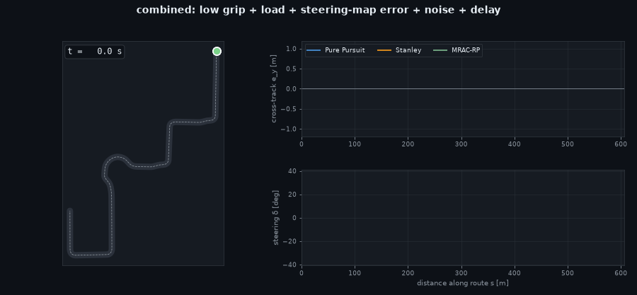
  <br><sub>Replay of the logged runs: position on the route, cross-track error and steering for three controllers.</sub>
</p>

## 💡 Key findings

| | Finding |
| --- | --- |
| 📈 | **Adaptation pays in proportion to plant change.** The error reduction from adapting correlates with how far θ̂ moved from its dry-road calibration (**r = −0.93** for MRAC-R over the 12 default-grip scenarios). The same pattern holds for adaptive MPC. |
| 🧮 | **MPC is the strongest all-rounder.** Calibrated or adaptive MPC had the lowest RMS error in 9 of 14 scenarios; the QP solves in 0.52 ms on average with OSQP (worst case 3.1 ms, about 6 % of the 50 ms control period). |
| 🎯 | **The physically correct gain can be the wrong one.** RLS correctly identified the yaw-rate gain (θ ≈ 3.36 m), but the MPC tracked best at θ ≈ 4.3 m (0.152 vs 0.080 m) because the kinematic model omits actuator and yaw lag. Calibrating the absolute value and adapting only the *relative* change fixed it. |
| 🤝 | **Two independent estimators agree.** Under steering-map error, MRAC (from tracking error) reached θ̂ = 4.72 m and RLS (from yaw rate) 4.78 m. |
| 🏆 | **Stanley wins when the car matches its calibration**: lowest error on nominal, heavy load, icy and noisy+delayed. |
| 🔧 | **Delay needs explicit handling.** Plain MPC oscillated under 150 ms delay + noise until forward-prediction delay compensation was added (offline 1.07 → 0.16 m). Plain high-gain MRAC is also fragile to delay. With 150 ms delay and noise it left the route and θ̂ drifted to 2.4× its true value. A Stanley-type surface, a gain cap and filtered adaptation fixed it. |
| ⚠️ | **Model-based control fails at the friction limit.** Near peak tyre force every MRAC *and* MPC variant left the road, because all assume a linear plant without a grip limit; geometric Stanley and Pure Pursuit stayed on. |
| 🛞 | **CARLA's default grip is about 2.2 g.** A skid-pad test maps `tire_friction` to measured grip; realistic wet and snow settings were not drivable on Town03. |

<p align="center">
  
</p>

## 📊 Results

<p align="center">
  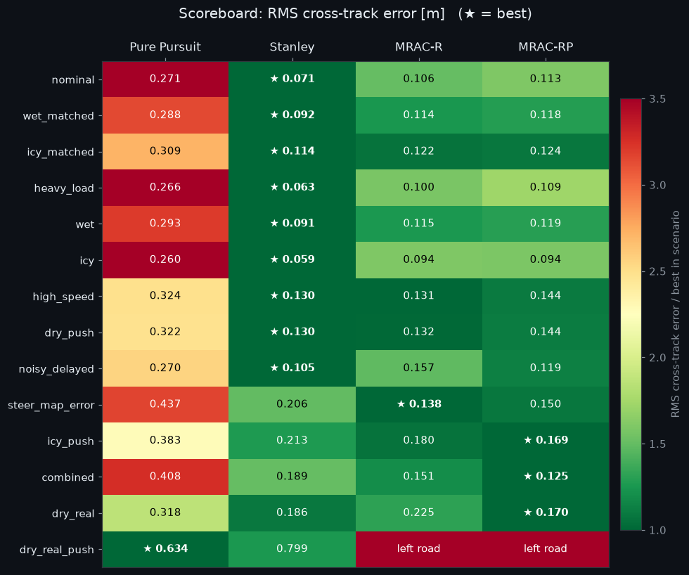
</p>

<details>
<summary><b>Full table: RMS / max cross-track error [m]</b> (bold = lowest RMS)</summary>

| Scenario | Pure Pursuit | Stanley | MRAC-R | MRAC-RP | MPC | Adaptive MPC |
| --- | --- | --- | --- | --- | --- | --- |
| nominal | 0.271 / 0.842 | **0.071** / 0.190 | 0.106 / 0.345 | 0.113 / 0.339 | 0.080 / 0.302 | 0.083 / 0.312 |
| wet_matched | 0.288 / 0.898 | 0.092 / 0.243 | 0.114 / 0.386 | 0.118 / 0.368 | **0.088** / 0.335 | 0.089 / 0.358 |
| icy_matched | 0.309 / 0.950 | 0.114 / 0.304 | 0.122 / 0.463 | 0.124 / 0.403 | 0.100 / 0.393 | **0.098** / 0.404 |
| heavy_load | 0.266 / 0.837 | **0.063** / 0.181 | 0.100 / 0.344 | 0.109 / 0.328 | 0.076 / 0.304 | 0.079 / 0.294 |
| wet | 0.293 / 0.915 | 0.091 / 0.240 | 0.115 / 0.383 | 0.119 / 0.364 | **0.088** / 0.333 | 0.090 / 0.357 |
| icy | 0.260 / 0.812 | **0.059** / 0.176 | 0.094 / 0.305 | 0.094 / 0.323 | 0.075 / 0.279 | 0.076 / 0.299 |
| high_speed | 0.324 / 1.010 | 0.130 / 0.313 | 0.131 / 0.420 | 0.144 / 0.426 | **0.094** / 0.329 | 0.099 / 0.351 |
| dry_push | 0.322 / 1.023 | 0.130 / 0.311 | 0.132 / 0.422 | 0.144 / 0.430 | **0.095** / 0.323 | 0.098 / 0.344 |
| noisy_delayed | 0.270 / 0.800 | **0.105** / 0.315 | 0.157 / 0.480 | 0.119 / 0.452 | 0.137 / 0.480 | 0.134 / 0.502 |
| steer_map_error | 0.437 / 1.244 | 0.206 / 0.461 | 0.138 / 0.486 | 0.150 / 0.454 | 0.131 / 0.449 | **0.111** / 0.402 |
| icy_push | 0.383 / 1.181 | 0.213 / 0.583 | 0.180 / 0.865 | 0.169 / 0.553 | 0.145 / 0.597 | **0.137** / 0.594 |
| combined | 0.408 / 1.111 | 0.189 / 0.485 | 0.151 / 0.572 | 0.125 / 0.440 | 0.149 / 0.540 | **0.120** / 0.456 |
| dry_real (μ ≈ 0.9) | 0.318 / 1.000 | 0.186 / 0.656 | 0.225 / 0.998 | 0.170 / 0.813 | 0.160 / 0.701 | **0.142** / 0.701 |
| dry_real_push | **0.634** / 2.114 | 0.799 / 2.550 | left road at 24 % | left road at 29 % | left road at 24 % | left road at 24 % |

Three noise seeds change RMS error by at most 0.002 m (combined: Stanley 0.190 ± 0.001,
MRAC-RP 0.124 ± 0.001). MRAC steers more actively: 13–20 °/s RMS in clean runs vs 9–13 °/s for
Stanley, and 82 vs 38 °/s in `noisy_delayed`. All numbers come from
[`results/summary.csv`](results/summary.csv); full tables in
[`results/final/tables.md`](results/final/tables.md).
</details>

<details>
<summary><b>All analysis figures</b></summary>

| | |
| --- | --- |
| 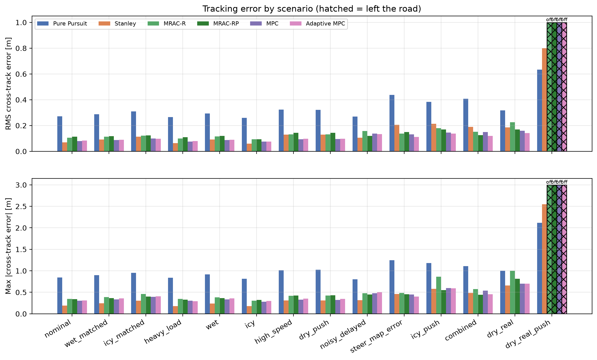 | 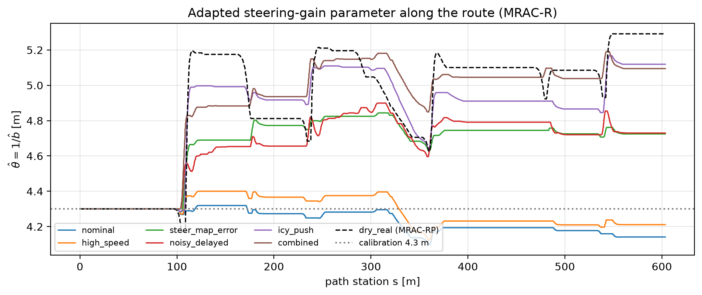 |
| 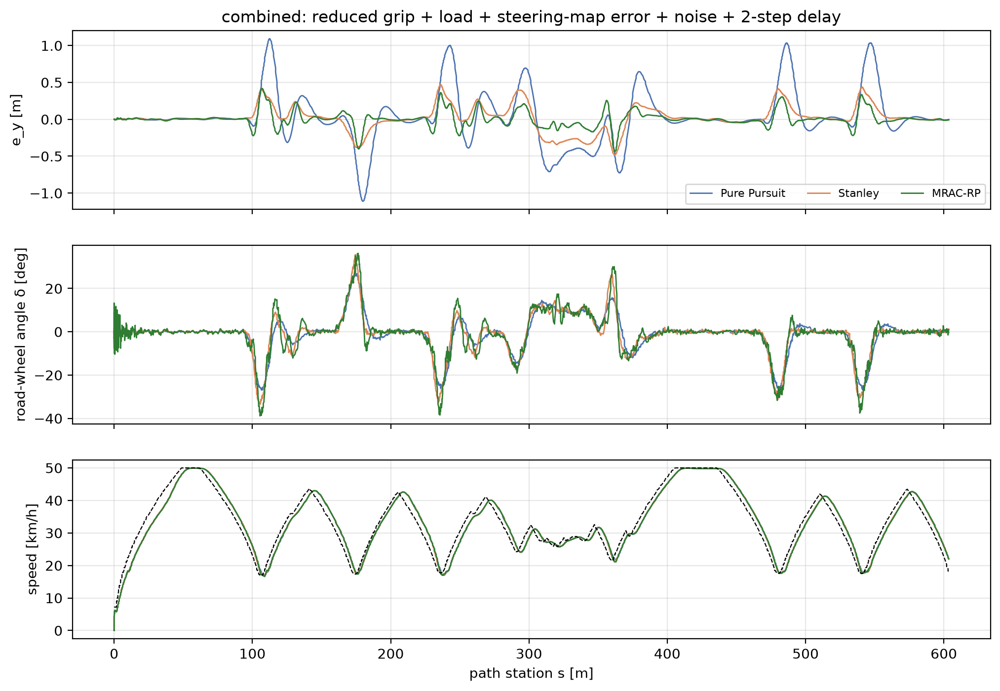 | 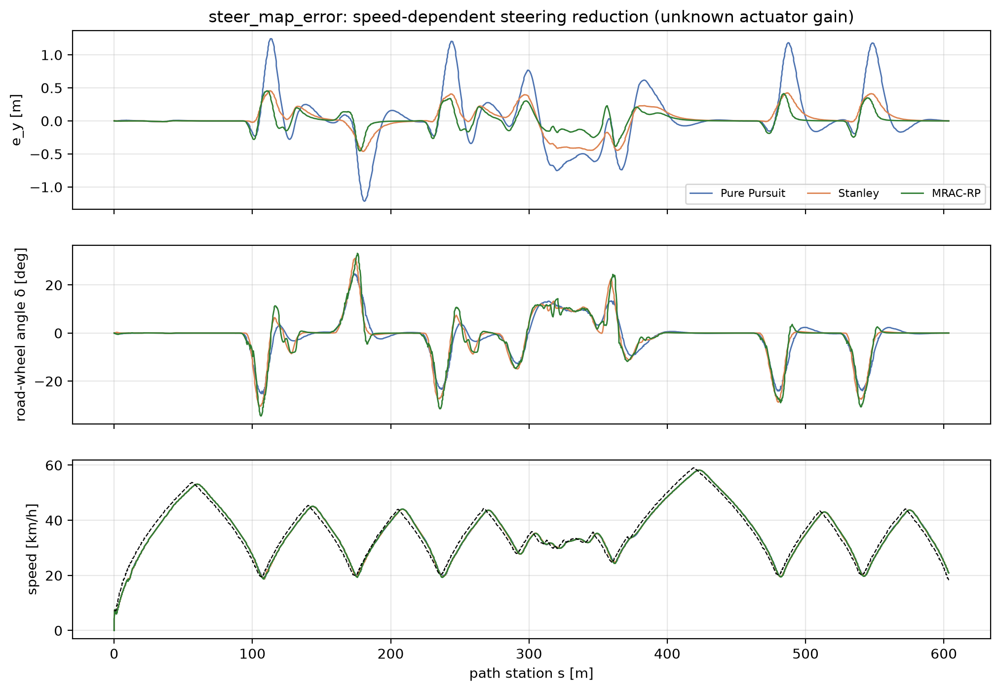 |
| 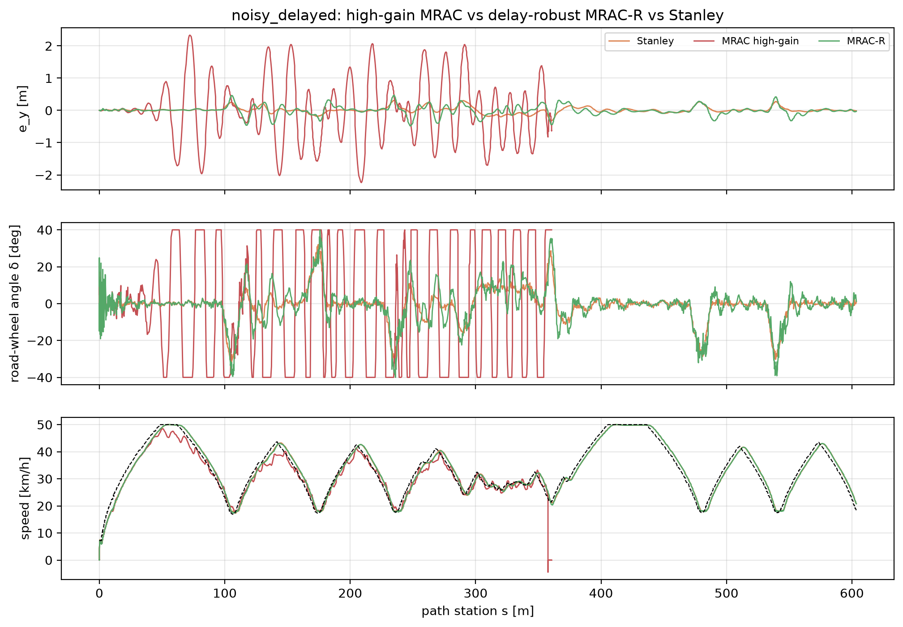 | 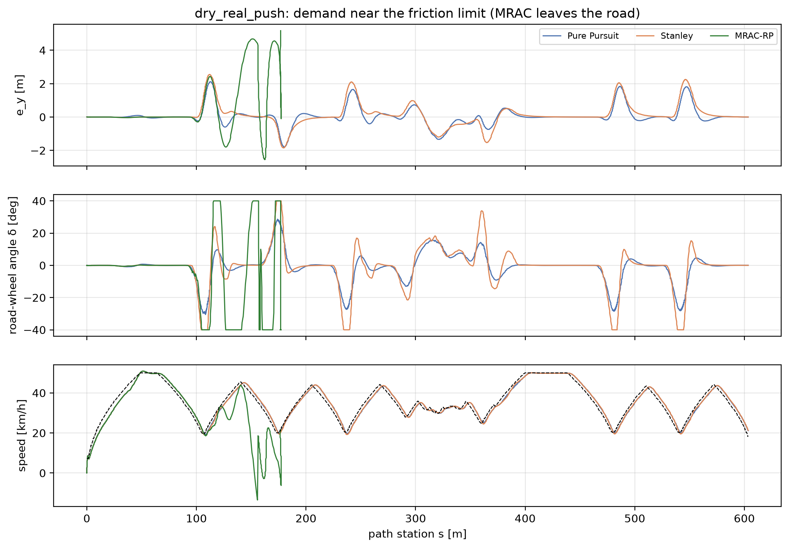 |

</details>

## 🧠 How it works

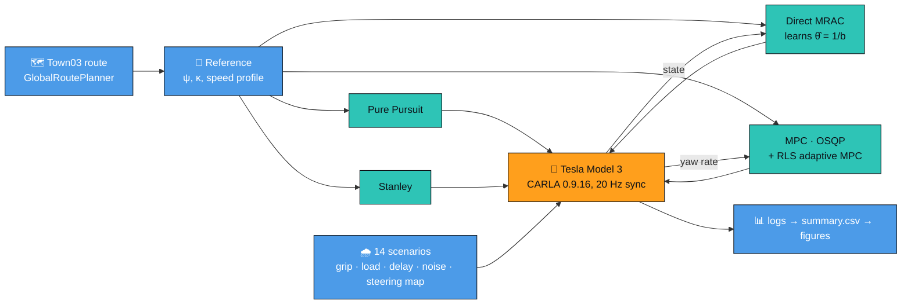

<p align="center">
  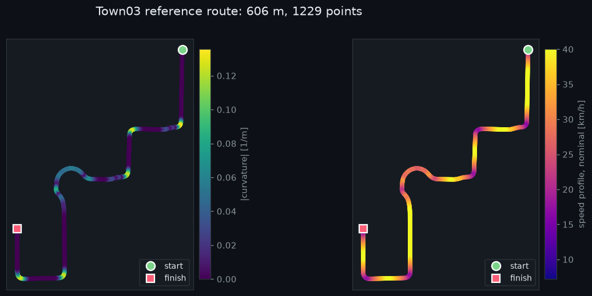
</p>

The adaptive law in short (full derivation, robust redesign and grip calibration in
[`docs/METHOD.md`](docs/METHOD.md)):

$$s = e_\psi + \arctan(\lambda e_y),\qquad \nu = -k s - f,\qquad \tan\delta = \frac{\hat\theta\,\nu}{v},\qquad \dot{\hat\theta} = -\gamma\,s\,\nu$$

$$V = \tfrac12 s^2 + \frac{b}{2\gamma}\tilde\theta^2 \ \Rightarrow\ \dot V = -k s^2 \le 0$$

| Name in code | Label | Description |
| --- | --- | --- |
| `pure_pursuit` | 🔵 Pure Pursuit | rear axle, look-ahead 0.35 v + 4 m (4–30 m) |
| `stanley` | 🟠 Stanley | front axle, k = 1.2, k_s = 1.0, no curvature feedforward |
| `adaptive_mrac_cal` | 🔴 high-gain MRAC | original design, θ̂₀ = 4.3 m |
| `adaptive_mrac_rob` | 🟢 **MRAC-R** | delay-robust MRAC (k_e = k_max = 2.0, filtered adaptation) |
| `adaptive_mrac_rob_prev` | 🟢 **MRAC-RP** | MRAC-R + 0.2 s curvature preview |
| `mpc_cal` | 🟣 **MPC** | linear MPC, N = 15 × 0.1 s, curvature preview, steering + rate limits, 0.1 s delay compensation, OSQP |
| `ampc_ratio` | 🩷 **Adaptive MPC** | MPC + RLS yaw-gain estimation, adapting the *relative* change from calibration |
| `ampc_cal`, `mpc_geom` | ⚪ ablations | absolute RLS adaptation; MPC with the geometric wheelbase |
| `*_fixed` | ⚪ ablation | same controller with adaptation off (γ = 0, θ = 4.3 m) |

<details>
<summary><b>Scenarios</b></summary>

| Group | Scenarios | What changes |
| --- | --- | --- |
| Baseline | `nominal` | 40 km/h, CARLA default grip |
| Speed | `high_speed`, `dry_push` | 70 km/h; 50 km/h at 4.5 m/s² lateral |
| Grip (relative to default) | `wet`, `icy`, `wet_matched`, `icy_matched`, `icy_push` | tyre friction × 0.55 or × 0.3 |
| Load | `heavy_load` | mass × 1.6 |
| Actuator | `steer_map_error` | CARLA's speed-dependent steering reduction left on |
| Sensing | `noisy_delayed` | 0.1 m / 0.5° noise, 150 ms steering delay |
| Mixed | `combined` | grip × 0.55, mass × 1.4, steering curve on, noise, 100 ms delay |
| Calibrated grip | `dry_real`, `dry_real_push` | measured μ ≈ 0.9, μ-aware speed profile |

All runs share one 606 m Town03 reference (spawn 174 → 15), one speed profile per scenario and the
same PI speed loop, so controllers differ only in their steering law.
</details>

## 🚀 Getting started

Requirements: Ubuntu 22.04/24.04, CARLA 0.9.16 (UE4), Python 3.10–3.12.

```bash
git clone https://github.com/munavirzaman-git/carla-adaptive-path-tracking.git
cd carla-adaptive-path-tracking
python3 -m venv .venv && source .venv/bin/activate
pip install -r requirements.txt
export CARLA_ROOT=/path/to/CARLA_0.9.16          # for agents.navigation (route planner)

python offline_check.py                           # no simulator needed
python offline_benchmark.py                       # all controllers incl. MPC vs unknown gain, delay, noise
```

Start the simulator (`$CARLA_ROOT/CarlaUE4.sh -quality-level=Low`), then:

```bash
python run_experiments.py -c stanley adaptive_mrac_rob_prev -s nominal combined --spectator
python record_demo.py -s combined -c stanley adaptive_mrac_rob_prev     # your own demo video
```

| Script | What it does |
| --- | --- |
| `run_experiments.py` | scenario × controller runs → `results/` (`-c`, `-s`, `--gains`, `--tag`, `--noise-seed`) |
| `record_demo.py` | chase / top-down camera + HUD → MP4, side-by-side MP4 and GIF |
| `skidpad.py` | flat OpenDRIVE pad: `tire_friction` → measured lateral grip |
| `make_figures.py` · `make_animations.py` | analysis figures; banner, scoreboard, route map, animated GIFs |
| `run_all.sh` · `make_media.sh` | reproduce every result (2–3 h) · every image and video (~20 min) |
| `offline_check.py` · `offline_benchmark.py` · `diag.py` | CARLA-free sanity check · controller benchmark · single-run diagnosis |

<details>
<summary><b>Repository layout</b></summary>

```
├── config.py            simulator, route and limit settings
├── vehicle_state.py     CARLA-free state containers and frame helpers
├── sim_utils.py         the only CARLA-specific code: connect, spawn, physics, frame conversion
├── reference_path.py    Town03 route -> smoothed path, curvature, speed profile, projection
├── controllers.py       Pure Pursuit, Stanley, direct MRAC, speed PI, named PRESETS
├── scenarios.py         the 16 scenario definitions (14 used in the study)
├── run_experiments.py   runs scenario x controller, logs traces and results/summary.csv
├── record_demo.py       camera + HUD recordings, side-by-side videos and GIFs
├── skidpad.py           tire_friction -> measured lateral grip
├── make_figures.py      analysis figures and tables -> results/final/
├── make_animations.py   banner, route map, scoreboard and animated GIFs -> media/
├── docs/METHOD.md       conventions, derivation, robust redesign, grip calibration
├── media/               images, GIFs and videos shown in this README
└── results/             summary.csv, reference route, final figures and tables
```
</details>

## ⚠️ Limitations

> [!WARNING]
> - **One route, one vehicle**: all results come from a single 606 m Town03 route.
> - **Simulator grip**: CARLA's default grip (≈ 2.2 g) is about twice a real car's, so "wet"/"icy"
>   are relative friction reductions. Realistic wet and snow `tire_friction` also removes cornering
>   stiffness and traction; the car could not complete Town03, so those scenarios are excluded.
> - **Kinematic error model**: tyre slip is absorbed into θ̂ rather than modelled.
> - **Friction limit**: MRAC and MPC both assume a linear plant without a grip limit, so both fail past peak tyre force.
> - **MPC model**: kinematic, with lag absorbed into the calibrated gain; a dynamic bicycle model with an explicit steering lag state is the next step.
> - **Preview–adaptation interaction**: with curvature preview, θ̂ drifts below its calibrated value on
>   calm roads (3.84–4.01 m), making MRAC-RP's adaptation 20–28 % worse than holding θ̂ fixed there.

## 🔭 Future work

Friction-aware MPC with grip constraints · dynamic-bicycle error model with tyre slip · CARLA's Project Chrono vehicle dynamics for realistic
low-grip roads · friction-limit-aware adaptation · μ-split and sudden ice patches to measure
adaptation speed · multiple towns and routes · ROS 2 nodes.

## 👤 Author

**Munavir Zaman P K** · [GitHub](https://github.com/munavirzaman-git) ·
ORCID [0009-0001-4537-6234](https://orcid.org/0009-0001-4537-6234)

Released under the [MIT License](LICENSE).
